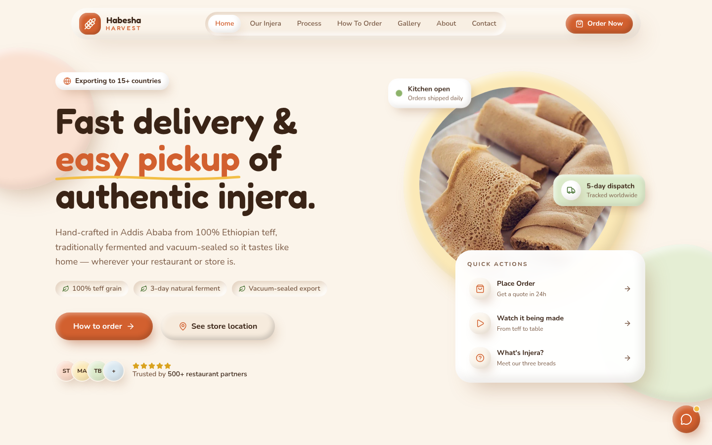
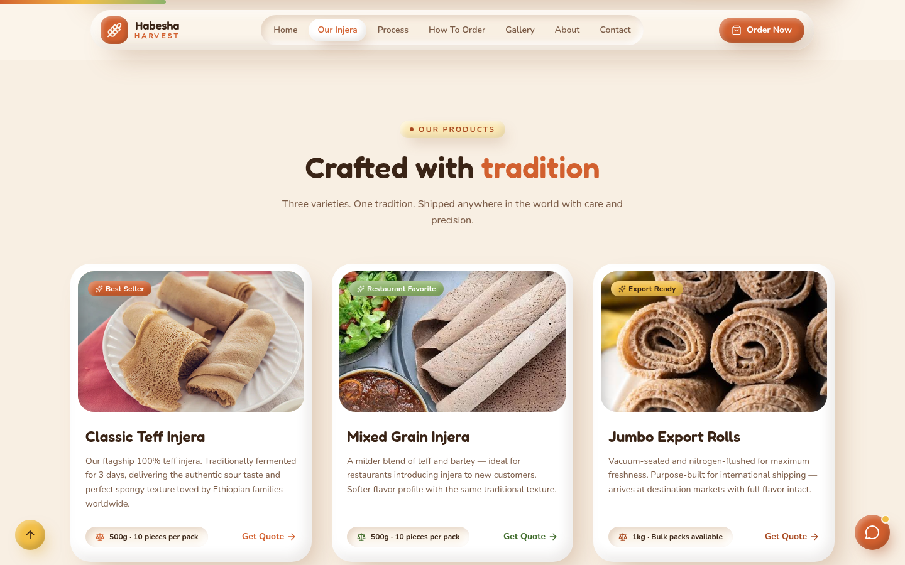
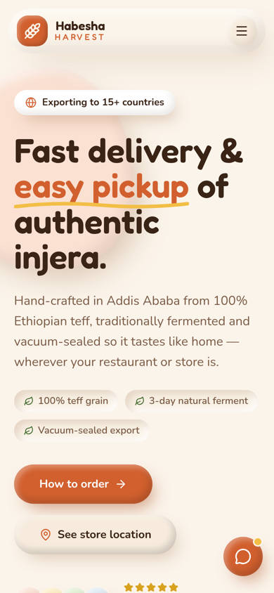

# Habesha Harvest

Authentic Ethiopian injera, exported worldwide. Habesha Harvest is the marketing website for a teff injera export business based in Addis Ababa. It presents the products, shows how the injera is made, explains how restaurants and stores can order, and collects quote requests.



<p align="center">
  
  &nbsp;
  
</p>

## Features

- **Hero** – headline, key selling points, quick actions and trust badges
- **Our Injera** – product categories and a showcase of Classic Teff, Mixed Grain and Jumbo Export Rolls
- **From Teff to Table** – process steps with embedded YouTube videos
- **How to Order** – a four-step guide from inquiry to worldwide shipping
- **Gallery** – injera on tables around the world
- **Client stories** – a testimonial carousel
- **About** – the story and heritage behind the brand
- **Contact / order form** – validated with react-hook-form and zod, including a country selector
- **Extras** – scroll progress bar, back-to-top button, chatbot widget and smooth scroll-reveal animations
- Fully responsive, with a soft claymorphism design system

## Tech stack

| Area | Tools |
| --- | --- |
| Framework | [Next.js 16](https://nextjs.org) (App Router), React 19 |
| Language | TypeScript |
| Styling | Tailwind CSS v4, custom clay utilities, tw-animate-css |
| UI components | shadcn/ui (Radix UI), lucide-react icons |
| Animation | framer-motion |
| Forms | react-hook-form, zod, country-list |
| Other | embla-carousel-react, sonner toasts, next/font (Fredoka & Nunito) |

## Getting started

Requirements: Node.js 20 or newer and npm.

```bash
git clone https://github.com/Jennah198/habesha-harvest.git
cd habesha-harvest
npm install
npm run dev
```

Open [http://localhost:3000](http://localhost:3000) in your browser.

### Scripts

| Command | What it does |
| --- | --- |
| `npm run dev` | Start the development server with hot reload |
| `npm run build` | Create an optimised production build |
| `npm run start` | Serve the production build |
| `npm run lint` | Run ESLint |

## Project structure

```
src/
├── app/
│   ├── layout.tsx        # Root layout, fonts and metadata
│   ├── page.tsx          # Home page – assembles all sections
│   └── globals.css       # Tailwind v4 theme tokens and clay utilities
├── components/
│   ├── layout/           # Navbar, Footer
│   ├── sections/         # Hero, Categories, ProductShowcase, VideoSection,
│   │                     # HowToOrder, Gallery, Feedback, About, ContactForm
│   └── ui/               # shadcn/ui primitives and small widgets
├── data/content.ts       # All site copy: products, testimonials, steps, stats
├── hooks/                # useCountUp, useScrollProgress
├── lib/utils.ts          # cn() class-name helper
└── types/                # Shared TypeScript types
public/images/            # Product and gallery photos
```

Most text on the site lives in `src/data/content.ts`, so you can update products, testimonials and stats without touching any components.

## Deployment

The site deploys to [Vercel](https://vercel.com) with no extra configuration:

1. Push the repository to GitHub.
2. In Vercel, choose **Add New → Project** and import the repository.
3. Keep the detected Next.js settings and click **Deploy**.

After that, every push to `main` triggers a new production deployment.
